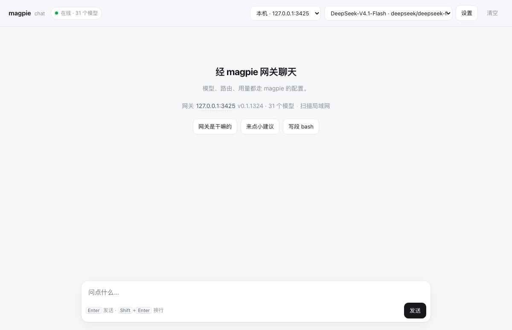
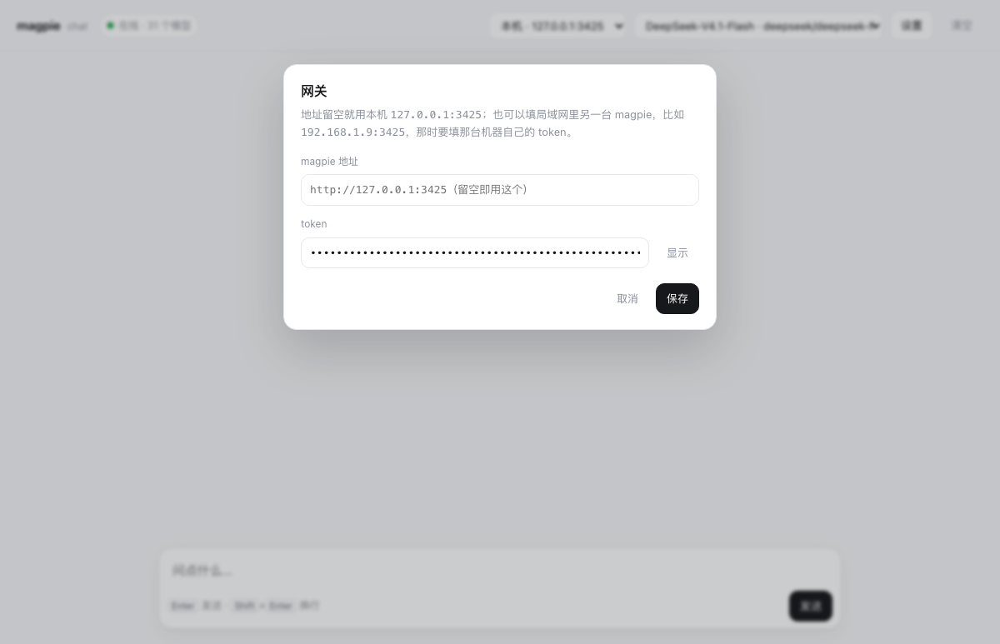
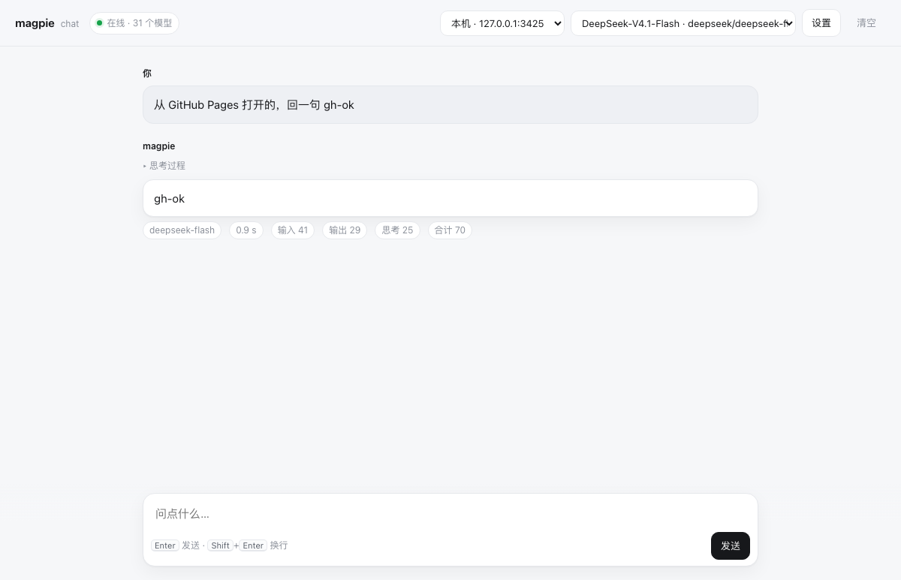
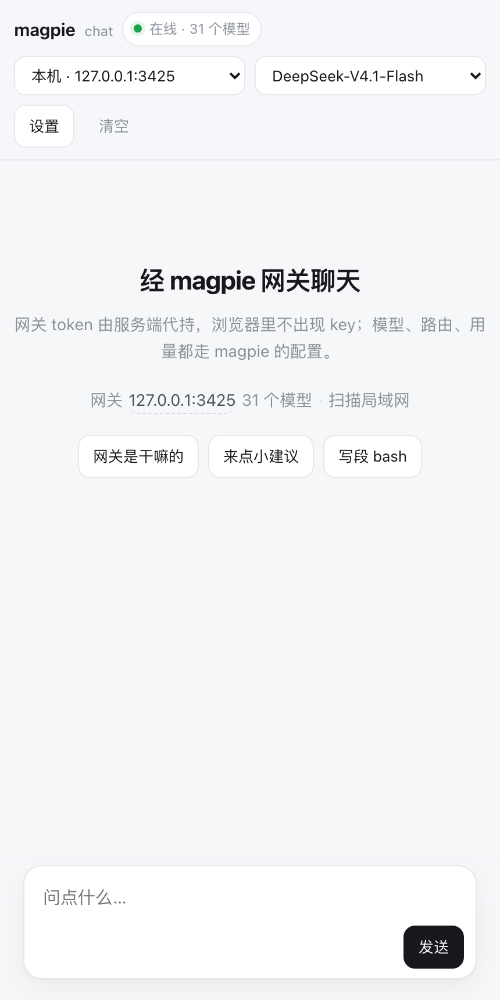

# magpie chat

一个单页聊天界面，把 [magpie](https://usemagpie.ai) 网关当成 OpenAI 兼容后端用：
静态页 + 本机一个小代理（`serve.py`），没有依赖、没有构建步骤。



## 特点

- **零依赖**：`index.html` 纯手写，`serve.py` 只用 Python 标准库
- **流式输出**：边收边显示，思考过程折叠，每轮显示耗时 / 输入 / 输出 / 思考 / 合计 token
- **模型下拉**：从网关 `/v1/models` 拉全量，按供应商分组，含跨供应商路由组 `auto/*`
- **网关可换**：顶栏下拉一键切；首页一行小字显示当前网关，点它就能改
- **局域网扫描**：并发扫一遍本网段 3425 端口，自动认出跑着 magpie 的机器
- **手机可用**：`--lan` 后同一 WiFi 下直接打开，窄屏布局单独调过
- **token 不落地**：局域网设备拿不到 key，由服务端代持并注入
- **GitHub Pages 模式**：静态页也能用，只要本机跑着 `serve.py` 当代理



## 快速开始

需要一个能用的 magpie 网关（默认在 `127.0.0.1:3425`），并签一把网关 key：

```bash
magpie gateway-key add chat          # 会打印 sk-magpie-key-…
```

然后：

```bash
git clone https://github.com/peng456/magpie-chat.git
cd magpie-chat
echo 'sk-magpie-key-…' > .token && chmod 600 .token
python3 serve.py
# → http://127.0.0.1:8088
```

打开就能聊。右上角 `设置` 里可以改网关地址和 token。

### 手机 / 局域网

```bash
python3 serve.py --lan
# → http://<你的局域网 IP>:8088
```

### GitHub Pages

仓库根目录就是静态站点（<https://peng456.github.io/magpie-chat/>）。
Pages 上只有静态文件，没法做代理，所以页面需要一个**本机跑着的 `serve.py`**：

```bash
python3 serve.py --lan --cors https://peng456.github.io
```

打开 Pages 页面，它会去连 `http://127.0.0.1:8088`（就在 `设置 › 代理地址` 里，可改）。
Chrome / Firefox 允许 https 页面访问 `127.0.0.1`，所以这条链路是通的；Safari 可能拦，
拦了就用本机地址或局域网地址直接开。



> 手机用 Pages 页面不行：https 页面访问 `http://<局域网 IP>` 属于混合内容，会被浏览器拦。
> 手机上直接开局域网地址即可。

## 三种用法对比

| 打开方式 | 地址 | 需要本机代理 | token 从哪来 |
|---|---|---|---|
| 本机 | `http://127.0.0.1:8088` | 就是它自己 | 服务端下发给页面，可改 |
| 局域网 / 手机 | `http://192.168.1.9:8088` | 就是它自己 | 服务端代持，页面拿不到 |
| GitHub Pages | `https://peng456.github.io/magpie-chat/` | 本机另跑 `serve.py --cors …` | 本机代理下发 |

## 为什么必须有 serve.py

magpie 网关不返回 CORS 头（`OPTIONS` 预检直接 404），浏览器里跨域直接调它会被拦。
`serve.py` 把页面和 `/v1/*` 放在同一个源上，页面照常带 `Authorization`，服务端只转发。

```
浏览器 ──HTTP──> serve.py ──HTTP──> magpie 网关 (127.0.0.1:3425)
                    │
                    └── 同一份进程还发静态页、做 /config.json 和局域网发现
```

## 安全设计

- **key 存服务端**：`.token`（`chmod 600`），不进 git（见 `.gitignore`）
- **本机的页面**才能从 `/config.json` 拿到 key；局域网设备只得到 `{"injected": true}`
- **代持的 key 只发给默认网关**：地址改成别的机器时，页面必须自带那台的 token
- **代理目标有白名单**：只放行 loopback、`10/8`、`172.16/12`、`192.168/16`、`100.64/10`（Tailscale）、
  `169.254/16`、`*.local`；公网要靠 `MAGPIE_GATEWAY_ALLOW` 显式加白，免得变成开放代理
- **跨域要显式开**：`--cors <origin>` 才回 CORS 头，默认不开

已知取舍：

- 局域网这层没有密码，同一个 WiFi 下谁打开这页都能用你的额度（但看不到 key）
- 扫描会把 token 发给「自报是 magpie」的主机做握手，同网段有人冒充就能骗到——介意就别点扫描

## 局域网扫描怎么做的

1. 从 `ifconfig` 取非回环网段，大于 /24 就只扫本机所在那一段
2. 96 线程并发打 `http://<ip>:3425/`，超时 0.5s，整段 /24 约 1.5–2 秒
3. 判定靠端口 + 响应里出现 `magpie` 字样：未授权时网关会回
   `no API key was sent: send a magpie gateway key…`，这就是指纹
4. 认出来后再用当前 token 握一次手，成功就显示版本和模型数，失败标 🔒



## 目录

```
index.html   页面（含远程代理模式、发现 UI、流式渲染）
serve.py     静态服务 + /v1 反代 + /config.json + /api/discover
.token       网关 key（不入库）
assets/      截图
```

## 可选参数

```
--port N             端口，默认 8088
--lan                监听 0.0.0.0
--cors ORIGIN        允许跨域来源，可重复/逗号分隔，"*" 为全放行
MAGPIE_GATEWAY       上游网关，默认 http://127.0.0.1:3425
MAGPIE_TOKEN         直接给 key（优先于 .token）
MAGPIE_TOKEN_FILE    换 key 文件位置
MAGPIE_GATEWAY_ALLOW 额外放行的目标主机，逗号分隔
```

## License

MIT，见 [LICENSE](LICENSE)。
